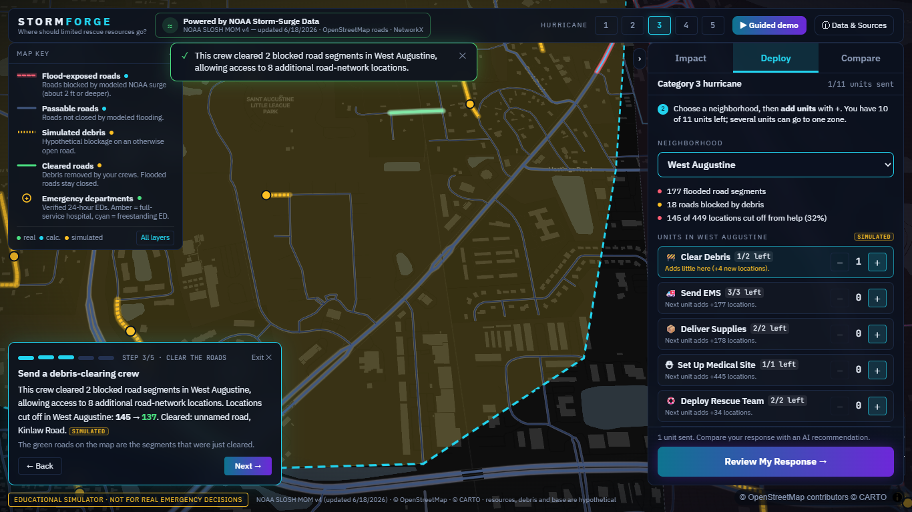

# STORMFORGE
**Critical Access Intelligence**



After a hurricane, the biggest problem isn't always knowing where flooding happened. It's knowing which neighborhoods are cut off, what resources are available, and where sending help will actually make a difference.

STORMFORGE is an interactive hurricane-response planning simulator that combines real NOAA storm-surge data, OpenStreetMap roads, road-network analysis, and Google's Gemma AI to explore those decisions. It's built around St. Augustine, Florida.

> Educational simulator. It is **not** a hurricane forecast and **not** an emergency dispatch tool.

## Why I built it

Flood maps tell you where the water might go. They don't tell you the thing a responder actually has to decide: with a handful of crews and ambulances, where do they go first? A road that's underwater doesn't just hurt the people on it. It can cut a whole neighborhood off from everything else. I wanted to see that second-order effect, and to see whether more resources in the right place really changes it.

## What it does

You pick a hurricane category (1 to 5). STORMFORGE shows which roads the modeled surge closes, which parts of town can no longer be reached, and how many verified 24-hour emergency departments are still reachable. Then you get 11 hypothetical units (2 debris crews, 3 EMS teams, 2 supply teams, 1 medical site, 2 water-rescue teams, 1 helicopter) and decide where to send them. Every time you place one, the road network is recalculated and you see what changed.

**A quick example:**
1. Choose Category 3. Davis Shores and Historic Downtown show up as almost completely cut off.
2. Select West Augustine, which is only partly cut off but has simulated debris blocking roads.
3. Send a debris crew. It clears blocked road segments, and the number of locations reachable from the response base goes up. The panel names the roads it cleared.
4. Add an EMS team. That's a different kind of coverage, so the app never adds the two together.
5. Ask Gemma for its own allocation of the same 11 units and compare it side by side with yours.

## What makes it interesting

- **Recently updated NOAA data.** The flood layers come from NOAA's National Storm Surge Risk Maps (SLOSH MOM, version 4, high tide). The National Hurricane Center's download page lists the Texas-to-Maine data as "Updated Version 4 - 6/18/2026". That is the date on the listing, not a claim about when the underlying model was created.
- **Real road geography.** Roads are OpenStreetMap, so closures happen on actual streets.
- **Deterministic analysis.** Every number comes from NetworkX graph calculations, not from an AI. Same inputs, same answer.
- **Gemma for recommendations only.** Gemma proposes where to send units and explains why. The backend validates the plan and recomputes every number itself. If Gemma isn't available, the app falls back to a clearly labeled non-Gemma plan.
- **Emergency-department access is its own calculation.** It uses a larger regional road network so the real emergency departments (Flagler Hospital, HCA Florida St. Augustine Emergency, AdventHealth Treaty Oaks ER) are properly connected. It is reported separately from EMS coverage, and deploying units doesn't change it.

## Real data vs. calculated vs. simulated

| Label | What it means | Examples |
|---|---|---|
| **REAL DATA** | Published or mapped by someone else | NOAA surge exposure, OpenStreetMap roads, emergency-department locations from operator websites |
| **CALCULATED** | Computed by STORMFORGE from the real data with a stated rule | Which roads are closed, which locations are cut off, emergency-department access, coverage after a deployment |
| **SIMULATED** | Made up for the demo | Debris, the 11-unit inventory, the response base, rescue radii |

NOAA doesn't measure debris or rescue feasibility, and nothing here pretends it does. The debris amounts (12, 25, 45, 65, 85 for categories 1 to 5) are scenario settings I picked, not real-world rates.

## Tech stack

Python, FastAPI, NetworkX, pandas, Shapely, React, TypeScript, Vite, Tailwind, MapLibre GL, OpenStreetMap (via OSMnx), NOAA SLOSH MOM, Google Gemma (`gemma-4-26b-a4b-it` through the Gemini API).

## How it works

1. **Hazard to roads.** The NOAA rasters give a depth class for each map cell. Each road segment is sampled about every 20 m, and a segment counts as closed if any sample is in a class of roughly 2 ft or deeper. OSM bridges are exempt because I don't know their deck heights.
2. **Roads to a graph.** Intersections become nodes and road segments become directed edges. A "location" in the app is one of those intersections, never a person.
3. **Allocation.** Debris, crews, EMS, supply, medical, water-rescue and helicopter effects are applied in a fixed order, so the result doesn't depend on click order. A rejected placement never uses up a unit.
4. **Emergency access.** A separate calculation routes over a 6 km regional graph to the verified emergency departments. The local and regional graphs share OSM node IDs, and tests check that the flood closures match edge by edge.
5. **Gemma.** The backend gives Gemma a list of valid actions. Gemma picks and explains. The backend checks inventory, feasibility and redundancy, then scores the plan.

More detail is in [`docs/CONTRACT_V2.md`](docs/CONTRACT_V2.md), [`docs/MEDICAL_ACCESS.md`](docs/MEDICAL_ACCESS.md), [`docs/GEMMA.md`](docs/GEMMA.md) and the demo script in [`docs/DEMO.md`](docs/DEMO.md).

## Run it yourself

You need Python 3.13 and Node 20+.

```bash
# backend
cd backend
python -m pip install fastapi "uvicorn[standard]" networkx pandas shapely httpx python-dotenv pytest
python -m uvicorn app.main:app --port 8000

# frontend (new terminal)
cd frontend
npm install
npm run dev          # http://localhost:5173, proxies /api to :8000
```

**Gemma (optional):** copy `backend/.env.example` to `backend/.env` and set `GEMMA_API_KEY` (a Google AI Studio key). `.env` is git-ignored. Without a key everything works except the Gemma plan, which falls back to a labeled deterministic plan.

The NOAA crops and prebuilt road graphs are already in `data/`. Rebuilding them (`scripts/`) additionally needs geopandas, rasterio and osmnx.

**Tests**
```bash
cd backend && python -m pytest -q                    # offline, no live Gemma calls
cd frontend && npx tsc -b && npx vitest run && npm run build
```
Browser end-to-end scripts live in `scripts/e2e/` (see the README there).

## Limitations

- It's an educational simulator, not a live forecast, and not an operational dispatch system.
- Flood exposure is modeled: NOAA's maps are planning envelopes across many storms, not event-specific depths. NoData means unknown, not dry. The closure rule is my illustrative choice.
- Debris, resources, the response base and rescue assumptions are hypothetical.
- Emergency-department positions are approximate and entrances aren't verified. Two of the three were placed from a street address or an intersection.
- No real-time traffic, ambulance speeds or travel times. Coverage uses assumed distances (1.5 km for EMS and supply, 500 m for water rescue).
- Counts are road-network locations, not people, so nothing here says how many residents are affected.
- Study area is central St. Augustine only, with six provisional response zones that aren't official boundaries.

## What I learned / what I'd do next

The biggest lesson was how easy it is to get a convincing-looking number that's wrong. My first version said only 1 of 1,820 locations could reach a hospital in a Category 3 storm. Digging in, the single hospital sat just outside my road network and snapped onto a dead end. Part of that result was real (the roads right around it do flood), but part was an artifact of modeling one facility on a clipped map. Fixing it meant adding more verified emergency departments on a bigger network, and keeping that calculation honest and separate.

Next I'd like to add travel times and real station locations, verify emergency-department entrances, and extend it beyond St. Augustine.

## Credits

NOAA / National Hurricane Center storm-surge maps, OpenStreetMap contributors, CARTO basemap, MapLibre GL, and Google Gemma.
